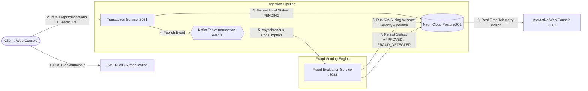

# Distributed FinTech Transaction & Fraud Monitor


An enterprise-grade, event-driven microservices application engineered to process financial transactions with low-latency ingestion, asynchronous Kafka messaging, role-based authorization (RBAC), real-time web telemetry, and automated sliding-window fraud detection algorithms.

---

## 🎯 Resume Highlights & Core Capabilities

* **Event-Driven Microservices Architecture:** Engineered decoupled Spring Boot 3.3 microservices (`transaction-service` on port `8081` and `fraud-service` on port `8082`) to process and validate financial transactions with low-latency guarantees.
* **REST API Security with JWT & RBAC:** Secured all endpoints using HMAC-SHA256 signed JSON Web Tokens (JWT) and Spring Security filter chains to enforce strict role-based access control (`ROLE_USER` for ingestion vs `ROLE_ADMIN` for auditing).
* **Apache Kafka Message Broker:** Implemented Apache Kafka as an event-driven broker (topic: `transaction-events`) to asynchronously decouple checkout ingestion from computationally heavy fraud evaluation.
* **60-Second Sliding-Window Velocity Algorithm:** Implemented temporal look-back database queries (`countByAccountIdAndTimestampAfter`) in Neon Serverless PostgreSQL to detect rapid velocity spikes (> 3 transactions / 60 seconds) and high-value anomalies (> $10,000).
* **Enterprise Containerization (Docker):** Standardized multi-stage `Dockerfile` definitions and full-cluster orchestration via `docker-compose.yml`.
* **Interactive Live Web Console:** Built a dark-mode real-time administrative dashboard on `http://localhost:8081` with live KPI metric counters, one-click fraud simulation triggers, and auto-refreshing audit logs.

---

## 🏗️ System Architecture



---

## ⚡ Multi-Tier Fraud Scoring Rules

1. **High-Value Anomaly Detection:** Flagged immediately if `amount > $10,000.00`.  
   *Result:* Status updated to `FRAUD_DETECTED` with reason `HIGH_VALUE_THRESHOLD_EXCEEDED`.
2. **Sliding-Window Velocity Spike Detection:** Evaluates total transactions for the specific `accountId` within a rolling 60-second window. If count $> 3$, flagged as a card-testing or bot burst attack.  
   *Result:* Status updated to `FRAUD_DETECTED` with reason `VELOCITY_SPIKE_EXCEEDED`.
3. **Verified Clean Transaction:** If all validation and velocity checks pass, marked as `APPROVED` with reason `VERIFIED_CLEAN`.

---

## 📁 Repository Structure

```text
fintech-fraud-monitor/
├── transaction-service/      # Ingestion API (Port 8081), Kafka Broker & Web Dashboard
│   ├── src/main/java/com/fintech/transaction/
│   │   ├── config/           # SecurityConfig (RBAC), KafkaConfig
│   │   ├── controller/       # AuthController, TransactionController
│   │   ├── model/            # Transaction.java entity
│   │   ├── repository/       # TransactionRepository
│   │   ├── security/         # JwtUtil, JwtAuthFilter
│   │   └── service/          # TransactionProducer
│   ├── src/main/resources/
│   │   ├── static/index.html # Interactive Real-Time Web Console
│   │   └── application.yml   # Neon DB & Kafka configuration
│   ├── Dockerfile            # Multi-stage production container
│   └── pom.xml
├── fraud-service/            # Fraud Scoring Engine (Port 8082) & Kafka Consumer
│   ├── src/main/java/com/fintech/fraud/
│   │   ├── model/            # Transaction.java entity
│   │   ├── repository/       # TransactionRepository (Sliding-Window Queries)
│   │   └── service/          # FraudDetectionConsumer (Velocity & Anomaly Rules)
│   ├── src/main/resources/
│   │   └── application.yml   # Kafka consumer group configuration
│   ├── Dockerfile            # Multi-stage production container
│   └── pom.xml
├── scripts/                  # 📁 Developer Automation & Testing Suite
│   ├── start_transaction_service.bat  # Boots Service 1 on port 8081
│   ├── start_fraud_service.bat        # Boots Service 2 on port 8082
│   ├── run_tests.bat                  # Runs test suite with policy bypass
│   └── test_fraud_scenarios.ps1       # Automated multi-scenario verification
├── docker-compose.yml        # Multi-container orchestration (K8s / Cloud ready)
├── .gitignore
├── LICENSE
└── README.md
```

---

## 🚀 Local Execution & Testing

### Option A: Standard Local Startup (Scripts)
1. **Start Transaction Ingestion Service (Port 8081 + Kafka Broker 9092):**
   ```cmd
   .\scripts\start_transaction_service.bat
   ```
2. **Start Fraud Evaluation Service (Port 8082):**
   ```cmd
   .\scripts\start_fraud_service.bat
   ```
3. **Open the Web Console:**
   Navigate to 👉 **`http://localhost:8081`** in your browser.

### Option B: Enterprise Container Orchestration (Docker)
```bash
docker compose up -d
```
*Spins up Zookeeper, Kafka broker, PostgreSQL, `transaction-service`, and `fraud-service` in isolated Linux containers.*

### Option C: Run the Automated Verification Suite
```powershell
.\scripts\run_tests.bat
```
*(Automatically tests JWT login, normal $500 transactions, $25,000 high-value anomalies, and rapid velocity bursts).*

---

## 📜 License
This project is licensed under the MIT License - see the [LICENSE](LICENSE) file for details.
