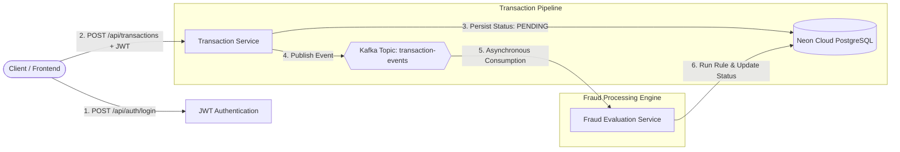

# Distributed FinTech Transaction & Fraud Monitor


An enterprise-grade, event-driven microservices application engineered to process financial transactions with low-latency ingestion, asynchronous Kafka messaging, and automated fraud detection algorithms.

---

## System Architecture



---

## Architectural Highlights & Engineering Decisions

* **Asynchronous Decoupling via Apache Kafka:** Instead of running heavy fraud algorithms synchronously during transaction ingestion (which causes HTTP timeouts and degrades user experience), transaction ingestion is completely decoupled from fraud analysis using Apache Kafka topics.
* **Stateless Security (JWT):** All REST API endpoints are protected using Spring Security with HMAC-signed JSON Web Tokens (JWT) for stateless client authorization.
* **Cloud Database Persistence:** Utilizes Neon Serverless PostgreSQL for resilient relational storage, tracking transaction lifecycles across `PENDING`, `APPROVED`, and `FRAUD_DETECTED` states.
* **Fault Tolerance & Scalability:** If the Fraud Service experiences downtime, the Transaction Service remains completely unaffected. Transactions continue to ingest safely into the Kafka buffer and are processed once the consumer comes back online.

---

## Technology Stack

* **Language:** Java (JDK 21)
* **Framework:** Spring Boot 3.3 (Spring Web, Spring Data JPA, Spring Security)
* **Message Broker:** Apache Kafka (Event-driven asynchronous messaging)
* **Database:** PostgreSQL (Neon Serverless Cloud)
* **Security:** JSON Web Tokens (JWT)
* **Build Tool:** Maven

---

## Data Flow & Processing Lifecycle

1. **Authentication:** Client submits credentials to `/api/auth/login` and receives a signed Bearer JWT token.
2. **Transaction Ingestion:** Client issues a `POST` request to the **Transaction Service** with transaction parameters and the JWT in the `Authorization` header.
3. **Initial Persistence:** The Transaction Service saves the record in PostgreSQL with status `PENDING` and returns an immediate response to the client.
4. **Event Publishing:** An asynchronous event is dispatched to the Kafka broker on topic `transaction-events`.
5. **Background Consumption:** The **Fraud Service** continuously polls the `transaction-events` topic.
6. **Fraud Analysis:** When an event is consumed, the detection algorithm evaluates the transaction criteria (e.g., velocity spikes, high-value anomaly thresholds) and updates the PostgreSQL record to either `APPROVED` or `FRAUD_DETECTED`.

---

## Repository Structure

```text
fintech-fraud-monitor/
├── transaction-service/      # Ingestion API & Kafka Event Producer
│   ├── src/main/java/com/fintech/transaction/
│   └── pom.xml
├── fraud-service/            # Kafka Event Consumer & Fraud Evaluation Engine
│   ├── src/main/java/com/fintech/fraud/
│   └── pom.xml
├── .gitignore
├── LICENSE
└── README.md
```

---

## License
This project is licensed under the MIT License - see the [LICENSE](LICENSE) file for details.
