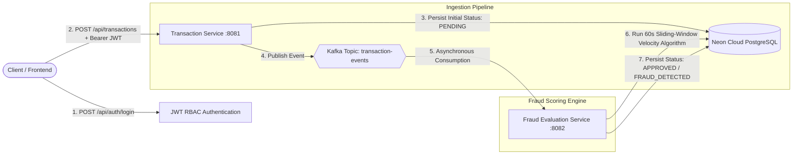

# Distributed FinTech Transaction & Fraud Monitor


An enterprise-grade, event-driven microservices application engineered to process financial transactions with low-latency ingestion, asynchronous Kafka messaging, role-based authorization (RBAC), and automated sliding-window fraud detection algorithms.

---

## 🏗️ System Architecture



---

## ⚡ Architectural Highlights & Engineering Decisions

* **Asynchronous Decoupling via Apache Kafka:** Rather than executing heavy fraud evaluation synchronously during checkout (which causes HTTP 504 timeouts and poor user experience), transaction ingestion is completely decoupled from fraud analysis using Apache Kafka.
* **Sliding-Window Velocity Spike Algorithm:** Implements a dynamic 60-second sliding-window look-back query (`countByAccountIdAndTimestampAfter`) to detect card-testing bots and rapid transaction velocity spikes (>3 transactions/min).
* **Multi-Tier Fraud Rules:** Enforces dual-layer fraud detection:
  1. **High-Value Anomaly:** Flagged if `amount > $10,000`.
  2. **Velocity Spike:** Flagged if transaction count $> 3$ in a 60-second rolling window.
  3. **Verified Clean:** Marked as `APPROVED` if all checks pass.
* **Role-Based Access Control (RBAC):** Enforces fine-grained authorization via Spring Security and HMAC-SHA256 JWT claims:
  * `ROLE_USER`: Can submit transactions (`POST /api/transactions`).
  * `ROLE_ADMIN`: Can audit and inspect all transactions (`GET /api/transactions`).
* **Resilient Cloud Persistence:** Utilizes Neon Serverless PostgreSQL with SSL encryption for relational state tracking across `PENDING`, `APPROVED`, and `FRAUD_DETECTED` lifecycles.

---

## ⚙️ Technology Stack

* **Language:** Java 21 (JDK 21)
* **Framework:** Spring Boot 3.3 (Spring Web, Spring Data JPA, Spring Security)
* **Message Broker:** Apache Kafka (Topic: `transaction-events`)
* **Database:** PostgreSQL (Neon Serverless Cloud with SSL)
* **Security:** JSON Web Tokens (JWT) with Role-Based Access Control (RBAC)
* **Build Tool:** Maven

---

## 📁 Repository Structure

```text
fintech-fraud-monitor/
├── transaction-service/      # Ingestion API (Port 8081) & Kafka Producer
│   ├── src/main/java/com/fintech/transaction/
│   │   ├── config/           # SecurityConfig (RBAC), KafkaConfig
│   │   ├── controller/       # AuthController, TransactionController
│   │   ├── model/            # Transaction.java entity
│   │   ├── repository/       # TransactionRepository
│   │   ├── security/         # JwtUtil, JwtAuthFilter
│   │   └── service/          # TransactionProducer
│   ├── .env.example
│   └── pom.xml
├── fraud-service/            # Fraud Scoring Engine (Port 8082) & Kafka Consumer
│   ├── src/main/java/com/fintech/fraud/
│   │   ├── model/            # Transaction.java entity
│   │   ├── repository/       # TransactionRepository (Sliding-Window Queries)
│   │   └── service/          # FraudDetectionConsumer (Velocity & Anomaly Rules)
│   ├── .env.example
│   └── pom.xml
├── .gitignore
├── LICENSE
└── README.md
```

---

## 🚀 Quick Start Guide

### 1. Launch the Transaction Ingestion Service
```bash
cd transaction-service
./mvnw spring-boot:run
```
*Service boots up on port `8081` and initializes the embedded Kafka broker on port `9092`.*

### 2. Launch the Fraud Detection Service
```bash
cd fraud-service
./mvnw spring-boot:run
```
*Service boots up on port `8082` and begins polling topic `transaction-events`.*

---

## 📡 API Reference Guide & Testing Flows

### Step 1: Authenticate as a Standard User
```bash
USER_TOKEN=$(curl -s -X POST http://localhost:8081/api/auth/login \
  -H "Content-Type: application/json" \
  -d '{"username": "john_doe", "role": "ROLE_USER"}' | jq -r .token)
```

### Step 2: Submit a Clean Transaction (< $10,000)
```bash
curl -X POST http://localhost:8081/api/transactions \
  -H "Authorization: Bearer $USER_TOKEN" \
  -H "Content-Type: application/json" \
  -d '{"accountId": "ACC-1001", "amount": 250.00, "currency": "USD"}'
```
*Immediate Response: Returns status `PENDING`. Downstream `fraud-service` evaluates it and updates to `APPROVED` in PostgreSQL.*

### Step 3: Trigger a High-Value Anomaly Fraud Check (> $10,000)
```bash
curl -X POST http://localhost:8081/api/transactions \
  -H "Authorization: Bearer $USER_TOKEN" \
  -H "Content-Type: application/json" \
  -d '{"accountId": "ACC-1001", "amount": 15000.00, "currency": "USD"}'
```
*Evaluated by `fraud-service` $\rightarrow$ Status updated to `FRAUD_DETECTED` with reason `HIGH_VALUE_THRESHOLD_EXCEEDED`.*

### Step 4: Trigger a Sliding-Window Velocity Spike (Card Testing Attack)
Submit 4 rapid transactions within 60 seconds for the same account:
```bash
for i in {1..4}; do
  curl -s -X POST http://localhost:8081/api/transactions \
    -H "Authorization: Bearer $USER_TOKEN" \
    -H "Content-Type: application/json" \
    -d "{\"accountId\": \"ACC-2002\", \"amount\": 10.00, \"currency\": \"USD\"}"
done
```
*The 4th transaction trips the sliding-window threshold ($>3$ txns in 60s) $\rightarrow$ Status updated to `FRAUD_DETECTED` with reason `VELOCITY_SPIKE_EXCEEDED`.*

### Step 5: Audit All Transactions (Admin Only)
```bash
ADMIN_TOKEN=$(curl -s -X POST http://localhost:8081/api/auth/login \
  -H "Content-Type: application/json" \
  -d '{"username": "admin_audit", "role": "ROLE_ADMIN"}' | jq -r .token)

curl -X GET http://localhost:8081/api/transactions \
  -H "Authorization: Bearer $ADMIN_TOKEN"
```

---

## 📜 License
This project is licensed under the MIT License - see the [LICENSE](LICENSE) file for details.
