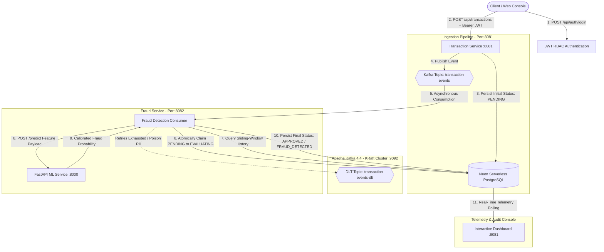

# Distributed FinTech Transaction & Fraud Monitor


An enterprise-grade, event-driven microservices platform engineered for real-time financial transaction ingestion, distributed stream processing, and multi-tier hybrid fraud evaluation combining temporal sliding-window queries with calibrated machine learning inference.

---

## 🎯 Resume & Architecture Highlights

* **Event-Driven Streaming Architecture:** Decoupled Spring Boot 3.3 microservices communicating asynchronously over Apache Kafka 4.4 in standalone KRaft mode (no ZooKeeper required).
* **Multi-Tier Hybrid Fraud Engine:** Combines hard business constraints, currency validation guards, 60-second sliding-window temporal queries (`countByAccountIdAndTimestampAfter`) in Neon PostgreSQL, and real-time ML scoring against a calibrated probability threshold.
* **Calibrated Machine Learning Service:** High-performance Python FastAPI service serving a calibrated Random Forest pipeline (`CalibratedClassifierCV`) delivering well-calibrated posterior fraud risk scores under 50ms latency.
* **Dead-Letter Topic (DLT) & Resilience:** Bounded consumer retries (2 retries, 1000ms delay) with dead-letter queue routing (`transaction-events-dlt`) to isolate poison-pill messages and prevent consumer group starvation.
* **Stateless Security with JWT & RBAC:** Enforces strict role-based access control (`ROLE_USER`, `ROLE_CLIENT`, `ROLE_AUDITOR`, `ROLE_ADMIN`) with HMAC-SHA256 signed JWT tokens and account ownership enforcement (SEC-06).
* **Zero-Secret Cloud Configuration:** Full externalization of sensitive database and JWT credentials across all environments, backed by comprehensive `.env.example` templates.
* **Real-Time Web Telemetry Dashboard:** Dark-mode responsive administrative console with live KPI metric counters, one-click fraud simulation triggers, and auto-polling transaction audit feeds.

---

## 🏗️ System Architecture



---

## ⚡ Multi-Tier Fraud Decision Hierarchy

Incoming transactions are evaluated strictly in the following priority order:

| Tier | Evaluation Stage | Condition | Status | Action / Audit Reason |
| :---: | :--- | :--- | :---: | :--- |
| **1** | **Sliding-Window Velocity** | $> 3$ transactions in rolling 60s window | `FRAUD_DETECTED` | `VELOCITY_SPIKE_EXCEEDED` (Catches burst testing & bot attacks) |
| **2** | **Currency Validation** | Currency not in supported set (`USD`) | `MANUAL_REVIEW` | `UNSUPPORTED_CURRENCY_REQUIRES_MANUAL_REVIEW` |
| **3** | **High-Value Anomaly** | Amount $> \$10,000.00\text{ USD}$ | `FRAUD_DETECTED` | `HIGH_VALUE_THRESHOLD_EXCEEDED` |
| **4** | **Calibrated ML Scoring** | Risk Score $\ge 0.14$ (Calibrated threshold) | `FRAUD_DETECTED` | `ML_HIGH_RISK_DETECTED (Probability, Model: v1.0.0)` |
| **4b** | **Verified Clean** | Risk Score $< 0.14$ & all rules passed | `APPROVED` | `VERIFIED_CLEAN (ML Score, Model: v1.0.0)` |
| **5** | **Resilient Fallback** | ML service timeout or unreachable | `MANUAL_REVIEW` | Never auto-approved on upstream failure |

---

## 📁 Repository Structure

```text
fintech-fraud-monitor/
├── transaction-service/               # Ingestion API (Port 8081) & Web Dashboard
│   ├── src/main/java/com/fintech/transaction/
│   │   ├── config/                    # SecurityConfig (RBAC), KafkaConfig
│   │   ├── controller/                # AuthController, TransactionController
│   │   ├── dto/                       # LoginRequest DTO
│   │   ├── model/                     # Transaction entity, User entity
│   │   ├── repository/                # TransactionRepository, UserRepository
│   │   ├── security/                  # JwtUtil, JwtAuthFilter
│   │   └── service/                   # TransactionProducer
│   ├── src/main/resources/
│   │   ├── static/index.html          # Interactive Real-Time Web Console
│   │   └── application.yml            # Database & Kafka externalized config
│   ├── Dockerfile
│   └── pom.xml
├── fraud-service/                     # Fraud Detection Engine (Port 8082) & Kafka Consumer
│   ├── src/main/java/com/fintech/fraud/
│   │   ├── client/                    # DefaultMlFraudScoringClient (HTTP REST client)
│   │   ├── config/                    # KafkaConsumerConfig (DLT, BackOff, ErrorHandler)
│   │   ├── dto/                       # FraudPredictionRequest/Response
│   │   ├── exception/                 # RetryableTransactionException, MlScoringException
│   │   ├── model/                     # Transaction entity
│   │   ├── repository/                # TransactionRepository (Atomic claim & sliding-window)
│   │   └── service/                   # DefaultFraudDecisionEngine, FeatureExtractor
│   ├── src/main/resources/
│   │   └── application.yml            # Consumer group & threshold configuration
│   ├── Dockerfile
│   └── pom.xml
├── ml-service/                        # Machine Learning Microservice (FastAPI, Port 8000)
│   ├── app/
│   │   ├── models/                    # Serialized joblib pipeline & metadata
│   │   ├── main.py                    # FastAPI entrypoint (/health, /predict)
│   │   └── schemas.py                 # Pydantic request/response validation
│   ├── data/
│   │   ├── generate_dataset.py        # Synthetic transaction data generator
│   │   └── train_and_evaluate.py      # Pipeline training & probability calibration
│   ├── tests/                         # Pytest unit & integration suite
│   ├── Dockerfile
│   └── requirements.txt
├── scripts/                           # Developer Automation & Live Harnesses
│   ├── start_kafka.bat                # Apache Kafka 4.4 launcher
│   ├── start_transaction_service.bat  # Boots Transaction Service on :8081
│   ├── start_fraud_service.bat        # Boots Fraud Service on :8082
│   ├── test_fraud_scenarios.ps1       # Automated multi-scenario live verification
│   ├── verify_live_ml_integration.ps1 # Java-to-FastAPI live integration runner
│   └── run_tests.bat                  # Full Maven test suite runner
├── docker-compose.yml                 # Multi-container orchestration specification
├── .env.example                       # Environment variable template
├── .gitignore
├── LICENSE
└── README.md
```

---

## 🔐 Environment Variables & Security Configuration

All sensitive secrets are externalized from source control. Before running the services, configure the following variables in your environment or via `.env`:

| Variable | Description | Example / Default |
| :--- | :--- | :--- |
| `SPRING_DATASOURCE_URL` | PostgreSQL JDBC Connection URL | `jdbc:postgresql://<host>:5432/<db>?sslmode=require` |
| `SPRING_DATASOURCE_USERNAME` | PostgreSQL Username | `neondb_owner` |
| `SPRING_DATASOURCE_PASSWORD` | PostgreSQL Password | *[Confidential]* |
| `JWT_SECRET` | HMAC-SHA256 Signing Secret (min 256 bits) | `404E635266556A586E3272357538782F413F4428472B4B6250645367566B5970` |
| `SPRING_KAFKA_BOOTSTRAP_SERVERS` | Kafka Broker Bootstrap Address | `localhost:9092` |
| `ML_SERVICE_URL` | Python FastAPI Inference Endpoint | `http://localhost:8000` |

---

## 👥 Default Demo Accounts (Pre-Seeded in `dev` Profile)

| Username | Password | Role | Authorized Account | Access Scope |
| :--- | :--- | :--- | :--- | :--- |
| `admin` | `admin123` | `ROLE_ADMIN` | *All Accounts* | Full audit access, view all transactions, submit for any account |
| `auditor` | `auditor123` | `ROLE_AUDITOR` | *None* | Read-only audit log inspection |
| `client` | `client123` | `ROLE_CLIENT` | `ACC-CLIENT-101` | Transaction creation for own account |
| `user` | `user123` | `ROLE_USER` | `ACC-USER-101` | Transaction creation for own account |

---

## 🚀 Quickstart: Running the Application Locally

### 1. Start Apache Kafka 4.4.0 (KRaft Standalone)
```powershell
cd C:\tools\kafka_2.13-4.4.0
.\bin\windows\kafka-server-start.bat .\config\server.properties
```

### 2. Start Python FastAPI ML Service (Port 8000)
```powershell
cd E:\Project_Resume\fintech-fraud-monitor\ml-service
.\venv\Scripts\python.exe -m uvicorn app.main:app --host 127.0.0.1 --port 8000
```
*Verify via health check: `curl http://127.0.0.1:8000/health`*

### 3. Start Fraud Detection Engine (Port 8082)
```powershell
cd E:\Project_Resume\fintech-fraud-monitor\fraud-service
mvn spring-boot:run
```

### 4. Start Transaction Service & Web Dashboard (Port 8081)
```powershell
cd E:\Project_Resume\fintech-fraud-monitor\transaction-service
mvn spring-boot:run -Dspring-boot.run.profiles=dev
```

### 5. Access the Interactive Telemetry Console
Open your browser and navigate to:
👉 **`http://localhost:8081`**
*(Sign in with username `admin` and password `admin123`)*

---

## 🧪 Automated Testing & Verification Suite

### Run Live End-to-End Test Harness
```powershell
.\scripts\test_fraud_scenarios.ps1
```
Executes four automated scenarios against the live running cluster:
1. **Clean Ingestion:** Submits \$500.00 USD transaction &rarr; Verifies `APPROVED` with ML probability.
2. **High-Value Anomaly:** Submits \$25,000.00 USD transaction &rarr; Verifies immediate `FRAUD_DETECTED`.
3. **Sliding-Window Velocity Attack:** Fires 4 rapid transactions within 2 seconds &rarr; Verifies velocity limit breach.
4. **RBAC Security Audit:** Verifies non-admin role restrictions and account ownership protection.

### Run Java-to-FastAPI Live Integration Test (No Mocks)
```powershell
.\scripts\verify_live_ml_integration.ps1
```

---

## 📜 License
This project is licensed under the MIT License - see the [LICENSE](LICENSE) file for details.
